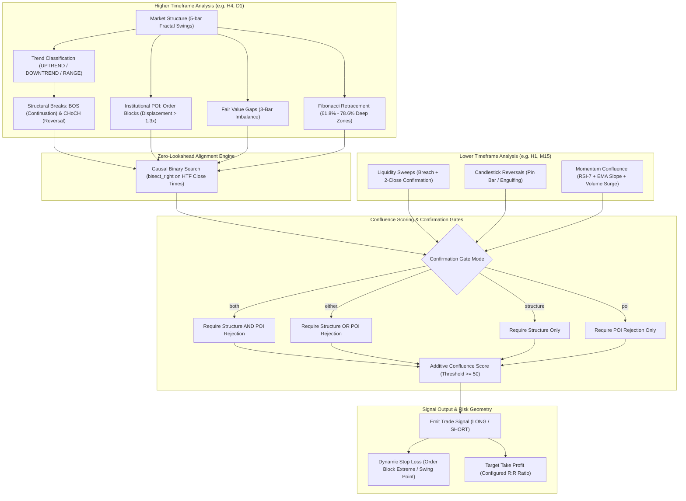

# Smart Money Concepts Multi-Timeframe Strategy Engine (SMC MTF)

[](https://www.python.org/downloads/)
[](https://opensource.org/licenses/MIT)
[](tests/)
[](docs/TIMEFRAME_ALIGNMENT.md)

A deterministic, point-in-time quantitative implementation of the **Smart Money Concepts (SMC)** trading methodology across multi-timeframe structures.

The framework integrates Higher-Timeframe (HTF) market structure, institutional Order Blocks (OB), Fair Value Gaps (FVG), Liquidity Sweeps, and Fibonacci Premium/Discount levels with Lower-Timeframe (LTF) candlestick triggers and momentum confirmation.

---

## Architecture Overview



---

## Key Features

- **Strict Causality & Zero Lookahead**: Higher-timeframe candles are strictly closed and timestamped before lower-timeframe decisions can observe them.
- **Institutional POI Modeling**: Quantitative displacement requirements for Order Blocks and point-in-time lifecycle tracking (Active $\to$ Mitigated $\to$ Invalidated).
- **Multi-Bar Liquidity Sweeps**: Requires price to breach a confirmed swing level and print two consecutive closes back within the range.
- **Microstructure Confirmation**: Lower-timeframe momentum triggers require multi-factor alignment: RSI(7), EMA(10)/EMA(20) cross, and volume surges ($> 1.3\times$ 20-SMA).
- **Flexible Confirmation Gates**: Supports configurable entry gates (`both`, `either`, `structure`, `poi`) to balance selectivity and trade opportunity.
- **Dynamic Risk Geometry**: Calculates stop loss based on active institutional invalidation levels and enforces minimum stop distance filters.

---

## Directory Structure

```
smc-mtf/
├── docs/                               # Quantitative documentation
│   ├── SMC_MECHANICS_GUIDE.md          # Full quantitative definition of all SMC mechanics
│   └── TIMEFRAME_ALIGNMENT.md          # Multi-timeframe causal alignment rules
├── src/                                # Core strategy modules
│   ├── __init__.py                     # Clean namespace exports
│   ├── types.py                        # Domain models (Candle, BarSeries, Signal, Position)
│   ├── constants.py                    # Strategic bounds, default weights, and thresholds
│   ├── indicators.py                   # Vectorized EMA, SMA, ATR, and RSI
│   ├── market_structure.py             # 5-bar fractal swings, BOS, and CHoCH detection
│   ├── zones.py                        # Order Blocks & FVG detection and lifecycle
│   ├── liquidity.py                    # Liquidity sweeps and Fibonacci retracement
│   ├── microstructure.py               # Candlestick triggers and LTF momentum
│   ├── strategy.py                     # SMCMultiTimeframeStrategy engine
│   └── data_loader.py                  # Parquet data loading and timeframe normalization
├── tests/                              # Unit test suite
│   ├── __init__.py
│   └── test_smc_mtf.py                 # 19 exhaustive tests verifying SMC logic
├── example_usage.py                    # Example script for feeding data and emitting signals
├── requirements.txt                    # Dependencies (numpy, pandas, pyarrow, pytest)
├── LICENSE                             # MIT License
└── README.md                           # Project documentation
```

---

## Quick Start

### 1. Installation

Clone the repository and install dependencies:

```bash
git clone https://github.com/phancongdong/smc-mtf.git
cd smc-mtf
pip install -r requirements.txt
```

### 2. Run Test Suite

Execute the comprehensive automated test suite covering all market structure, order block, FVG, liquidity sweep, and causal alignment mechanics:

```bash
pytest tests/ -v
```

Expected output:
```
tests/test_smc_mtf.py::test_market_structure_bos_requires_close_beyond_latest_confirmed_swing PASSED
tests/test_smc_mtf.py::test_bos_is_a_crossing_event_not_repeated_above_level PASSED
tests/test_smc_mtf.py::test_market_structure_bearish_choch_has_direction PASSED
tests/test_smc_mtf.py::test_zone_rejection_requires_large_directional_wick PASSED
tests/test_smc_mtf.py::test_newly_created_zone_cannot_reject_itself PASSED
tests/test_smc_mtf.py::test_fvg_first_revisit_active_but_old_mitigation_is_not PASSED
tests/test_smc_mtf.py::test_order_block_requires_displacement_close_through_prior_range PASSED
tests/test_smc_mtf.py::test_liquidity_sweep_requires_two_closes_back_inside PASSED
tests/test_smc_mtf.py::test_premium_discount_uses_structural_618_786_zones PASSED
tests/test_smc_mtf.py::test_premium_discount_uses_chronological_impulse_pair PASSED
tests/test_smc_mtf.py::test_position_risk_reward_target_geometry PASSED
tests/test_smc_mtf.py::test_trend_label_without_bos_or_choch_cannot_emit_signal PASSED
tests/test_smc_mtf.py::test_either_confirmation_mode_accepts_one_gate[True-False] PASSED
tests/test_smc_mtf.py::test_either_confirmation_mode_accepts_one_gate[False-True] PASSED
tests/test_smc_mtf.py::test_either_confirmation_mode_blocks_when_both_gates_are_missing PASSED
tests/test_smc_mtf.py::test_confirmation_mode_rejects_unknown_value PASSED
tests/test_smc_mtf.py::test_tp_atr_multiplier_controls_risk_reward PASSED
tests/test_smc_mtf.py::test_indicators_ema_sma_atr_rsi_vectorized PASSED
tests/test_smc_mtf.py::test_causal_htf_alignment_zero_lookahead PASSED

============================= 19 passed in 1.28s ==============================
```

### 3. Run Strategy Example

Run the demonstration script:

```bash
python example_usage.py
```

---

## Python API Usage

```python
from datetime import datetime, timezone
from src.strategy import SMCMultiTimeframeStrategy
from src.types import AssetClass, BarSeries, Candle, Timeframe

# 1. Initialize HTF (4h) and LTF (1h) BarSeries
# (Each series is a chronological sequence of validated Candle objects)
htf_series = BarSeries(candles=htf_candles, symbol="SOLUSDT", timeframe=Timeframe.H4)
ltf_series = BarSeries(candles=ltf_candles, symbol="SOLUSDT", timeframe=Timeframe.H1)

# 2. Instantiate and configure SMC Strategy Engine
strategy = SMCMultiTimeframeStrategy(
    confirmation_mode="either",  # "both", "either", "structure", or "poi"
    min_score=50,                # Minimum score required to emit signal (0-100)
    sl_atr_mult=1.5,             # Stop Loss ATR multiplier
    tp_atr_mult=3.0,             # Take Profit ATR multiplier (R:R = 2.0)
    max_hold_bars=20,            # Maximum horizon in LTF bars
)

# 3. Synchronize HTF structure and LTF caches
strategy.set_htf_data(htf_series)
strategy.set_ltf_data(ltf_series)

# 4. Generate Signal on latest closed LTF bar
current_idx = len(ltf_series) - 1
signal = strategy.generate_signal(ltf_series, current_idx)

if signal is not None:
    print(f"Direction : {signal.direction.label}")
    print(f"Score     : {signal.score}")
    print(f"Stop Loss : ${signal.sl:.2f}")
    print(f"Take Profit: ${signal.tp:.2f}")
    print(f"Reasons   : {signal.reasons}")
```

---

## Quantitative Mechanics Summary

| Component | Logic | Confirmation Criteria |
|---|---|---|
| **Swings** | 5-bar fractal | Center bar exceeds 2 left bars and 2 right bars |
| **BOS** | Trend continuation | Bar close breaks beyond previous confirmed swing extreme |
| **CHoCH** | Trend reversal | Bar close crosses protected swing extreme; flips trend regime |
| **Order Block** | Institutional inventory | Opposite candle before displacement closing outside prior range |
| **FVG** | 3-bar price imbalance | Gap between Bar 0 extreme and Bar 2 extreme |
| **Rejection Wick** | Active zone test | Lower wick $\ge 50\%$ body (Long) or Upper wick $\ge 50\%$ body (Short) |
| **Liquidity Sweep**| False breakout | Breach of swing level followed by 2 closes back within range |
| **Fibonacci** | Institutional value | Price inside deep discount (61.8% - 78.6%) or premium zone |
| **Momentum** | LTF confluence | Multi-factor score from RSI(7), EMA slope, and volume surge |

For full mathematical specifications, refer to [SMC Mechanics Guide](docs/SMC_MECHANICS_GUIDE.md) and [Timeframe Alignment](docs/TIMEFRAME_ALIGNMENT.md).

---

## License

This project is licensed under the MIT License - see the [LICENSE](LICENSE) file for details.
