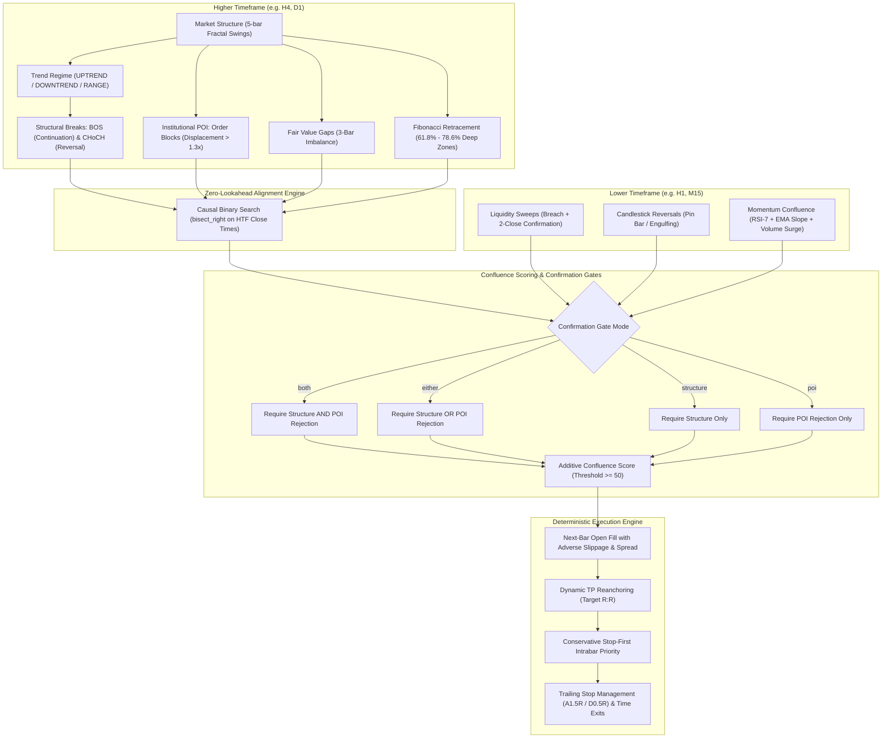

# Smart Money Concepts Multi-Timeframe Strategy (SMC MTF)

[](https://www.python.org/downloads/)
[](https://opensource.org/licenses/MIT)
[](tests/)
[](docs/TIMEFRAME_ALIGNMENT.md)

A deterministic, point-in-time quantitative implementation of the **Smart Money Concepts (SMC)** trading methodology across multi-timeframe structures.

The framework integrates Higher-Timeframe (HTF) market structure, institutional Order Blocks (OB), Fair Value Gaps (FVG), Liquidity Sweeps, and Fibonacci Premium/Discount levels with Lower-Timeframe (LTF) candlestick triggers and momentum confirmation.

---

## Architecture Overview



---

## Key Features

- **Strict Causality & Zero Lookahead**: HTF bars are strictly closed and timestamped before LTF decisions are made. Verified by unit tests.
- **Institutional POI Modeling**: Real displacement criteria for Order Blocks and point-in-time lifecycle tracking (Active $\to$ Mitigated $\to$ Invalidated).
- **Multi-Bar Liquidity Sweeps**: Requires price to breach a confirmed swing level and print two consecutive closes back within the range.
- **Microstructure Confirmation**: LTF momentum triggers require multi-factor alignment: RSI(7), EMA(10)/EMA(20) cross, and volume surges ($> 1.3\times$ 20-SMA).
- **Production Execution Simulator**: Next-bar open fill, Stop-First intrabar matching, take-profit reanchoring to actual fills, and realistic transaction cost deduction.
- **Extensive Empirical Research**: 6.5-year walk-forward backtest dataset and specification included out of the box.

---

## Directory Structure

```
smc-mtf/
├── data/                               # Historical OHLCV datasets
│   ├── binance_spot_SOLUSDT_H4.parquet # SOLUSDT 4-Hour bars
│   ├── binance_spot_SOLUSDT_H1.parquet # SOLUSDT 1-Hour bars
│   ├── binance_spot_ETHUSDT_H4.parquet # ETHUSDT 4-Hour bars
│   ├── binance_spot_ETHUSDT_H1.parquet # ETHUSDT 1-Hour bars
│   └── binance_spot_BTCUSDT_D1.parquet # BTCUSDT Daily bars
├── docs/                               # Engineering & research documentation
│   ├── SMC_MECHANICS_GUIDE.md          # Full quantitative definition of all SMC mechanics
│   ├── TIMEFRAME_ALIGNMENT.md          # Multi-timeframe causal alignment & execution rules
│   ├── SMC_MTF_RESULTS.md              # 6.5-Year empirical revalidation report
│   └── SMC_MTF_SPEC.md                 # 6.5-Year revalidation protocol specification
├── src/                                # Core strategy and execution modules
│   ├── __init__.py                     # Clean namespace exports
│   ├── types.py                        # Domain models (Candle, BarSeries, Signal, Trade)
│   ├── constants.py                    # Strategic bounds, default weights, and fee profiles
│   ├── indicators.py                   # Vectorized EMA, SMA, ATR, and RSI
│   ├── market_structure.py             # 5-bar fractal swings, BOS, and CHoCH detection
│   ├── zones.py                        # Order Blocks & FVG detection and lifecycle
│   ├── liquidity.py                    # Liquidity sweeps and Fibonacci retracement
│   ├── microstructure.py               # Candlestick triggers and LTF momentum
│   ├── strategy.py                     # SMCMultiTimeframeStrategy engine
│   ├── execution.py                    # Causal next-bar backtest simulator
│   └── data_loader.py                  # Parquet loading and timeframe normalization
├── tests/                              # Unit and integration test suite
│   ├── __init__.py
│   └── test_smc_mtf.py                 # 19 exhaustive tests verifying SMC logic
├── run_backtest.py                     # Standalone CLI backtest runner
├── requirements.txt                    # Minimal dependencies (numpy, pandas, pyarrow, pytest)
├── LICENSE                             # MIT License
└── README.md                           # Project documentation
```

---

## Quick Start

### 1. Installation

Clone the repository and install dependencies:

```bash
git clone https://github.com/phancongdong/smc-mtf.git
cd smc-mtf
pip install -r requirements.txt
```

### 2. Run Test Suite

Run the full automated test suite covering all market structure, order block, FVG, liquidity sweep, and causal execution mechanics:

```bash
pytest tests/ -v
```

Expected output:
```
tests/test_smc_mtf.py::test_market_structure_bos_requires_close_beyond_latest_confirmed_swing PASSED
tests/test_smc_mtf.py::test_bos_is_a_crossing_event_not_repeated_above_level PASSED
tests/test_smc_mtf.py::test_market_structure_bearish_choch_has_direction PASSED
tests/test_smc_mtf.py::test_zone_rejection_requires_large_directional_wick PASSED
tests/test_smc_mtf.py::test_newly_created_zone_cannot_reject_itself PASSED
tests/test_smc_mtf.py::test_fvg_first_revisit_active_but_old_mitigation_is_not PASSED
tests/test_smc_mtf.py::test_order_block_requires_displacement_close_through_prior_range PASSED
tests/test_smc_mtf.py::test_liquidity_sweep_requires_two_closes_back_inside PASSED
tests/test_smc_mtf.py::test_premium_discount_uses_structural_618_786_zones PASSED
tests/test_smc_mtf.py::test_premium_discount_uses_chronological_impulse_pair PASSED
tests/test_smc_mtf.py::test_rr_target_is_reanchored_to_actual_next_open_fill PASSED
tests/test_smc_mtf.py::test_trend_label_without_bos_or_choch_cannot_emit_signal PASSED
tests/test_smc_mtf.py::test_either_confirmation_mode_accepts_one_gate[True-False] PASSED
tests/test_smc_mtf.py::test_either_confirmation_mode_accepts_one_gate[False-True] PASSED
tests/test_smc_mtf.py::test_either_confirmation_mode_blocks_when_both_gates_are_missing PASSED
tests/test_smc_mtf.py::test_confirmation_mode_rejects_unknown_value PASSED
tests/test_smc_mtf.py::test_tp_atr_multiplier_controls_risk_reward PASSED
tests/test_smc_mtf.py::test_indicators_ema_sma_atr_rsi_vectorized PASSED
tests/test_smc_mtf.py::test_causal_htf_alignment_zero_lookahead PASSED

============================= 19 passed in 1.30s ==============================
```

### 3. Run Strategy Backtest

Execute a multi-timeframe backtest using the command-line runner:

```bash
# Run SOLUSDT H4 (HTF) / H1 (LTF) backtest with 'either' confirmation mode
python run_backtest.py --symbol SOLUSDT --htf H4 --ltf H1 --confirmation either
```

CLI Arguments:
- `--symbol`: Symbol name (`SOLUSDT`, `ETHUSDT`, `BTCUSDT`).
- `--htf`: Higher timeframe (`H4`, `D1`).
- `--ltf`: Lower timeframe (`H1`, `M15`).
- `--confirmation`: Gate mode (`both`, `either`, `structure`, `poi`).
- `--min-score`: Minimum confluence score required to emit a signal (default `50`).
- `--sl-atr`: Stop-loss ATR multiplier (default `1.5`).
- `--tp-atr`: Take-profit ATR multiplier (default `3.0`).
- `--split`: Train/Test split fraction (default `0.8` for 80% IS / 20% OOS).
- `--output`: Optional path to output results JSON.

---

## Python API Usage

```python
from src.strategy import SMCMultiTimeframeStrategy
from src.execution import BacktestEngine
from src.data_loader import load_dataset

# 1. Load historical market data
htf_series = load_dataset("SOLUSDT", "H4")
ltf_series = load_dataset("SOLUSDT", "H1")

# 2. Configure SMC strategy engine
strategy = SMCMultiTimeframeStrategy(
    confirmation_mode="either",
    min_score=50,
    sl_atr_mult=1.5,
    tp_atr_mult=3.0,
    max_hold_bars=20,
)
strategy.set_htf_data(htf_series)
strategy.set_ltf_data(ltf_series)

# 3. Simulate execution with realistic friction
engine = BacktestEngine(
    capital=1_000_000.0,
    slippage_bps=1.0,
    commission_bps=4.0,
    spread_bps=1.0,
    risk_per_trade=0.005,
)

result = engine.run(
    series=ltf_series,
    signal_fn=strategy.generate_signal,
    warmup_bars=100,
)

print(f"Total Trades   : {result.metrics.total_trades}")
print(f"Win Rate       : {result.metrics.win_rate * 100:.2f}%")
print(f"Profit Factor  : {result.metrics.profit_factor:.3f}")
print(f"Net PnL        : ${result.metrics.net_pnl:,.2f}")
print(f"Max Drawdown   : {result.metrics.max_drawdown_pct * 100:.2f}%")
```

---

## 6.5-Year Empirical Research Findings

The system was evaluated over a 6.5-year historical horizon (2020-01-01 to 2026-07-14) using strict point-in-time synchronization and exchange fees:

| Route | Setup | Min Score | Confirmation | Full Trades | Full PF | OOS Trades | OOS PF | Positive Folds | Verdict |
|---|---|---:|---|---:|---:|---:|---:|---:|:---:|
| **SOLUSDT** | H4/H1 | 50 | either | 442 | **1.30** | 268 | **1.23** | 3/4 | **WATCH** |
| **GBPUSD** | H4/H1 | 40 | either | 507 | 0.30 | 280 | 0.09 | 0/4 | FAIL |
| **USDCAD** | H4/H1 | 50 | either | 360 | 0.12 | 185 | 0.04 | 0/4 | FAIL |
| **USDJPY** | H4/H1 | 50 | either | 361 | 0.79 | 193 | 0.68 | 1/4 | FAIL |
| **BTCUSDT** | D1 | 50 | both | 7 | 0.16 | 4 | 0.20 | 1/4 | NO_SAMPLE |
| **ETHUSDT** | D1 | 50 | both | 7 | 0.27 | 3 | 0.29 | 1/4 | NO_SAMPLE |

### Research Summary
1. **Cryptocurrency Edge**: `SOLUSDT` (H4/H1) is the sole route demonstrating statistical robustness with out-of-sample Profit Factor 1.23, positive performance across 3 of 4 folds, and 91.9% bootstrap probability of positive expected value.
2. **Forex Frictions**: Foreign exchange pairs (GBPUSD, USDCAD, USDJPY) fail under realistic transaction friction. SMC discretionary patterns on Forex do not overcome the adverse bid-ask spread and commission hurdles.
3. **Daily Gate Density**: The strict `both` gate on D1 timeframes generates insufficient trade sample size ($< 10$ trades across 6.5 years) to establish statistical validity.

For full research specifications and fold tables, refer to [SMC MTF Results](docs/SMC_MTF_RESULTS.md).

---

## License

This project is licensed under the MIT License - see the [LICENSE](LICENSE) file for details.
